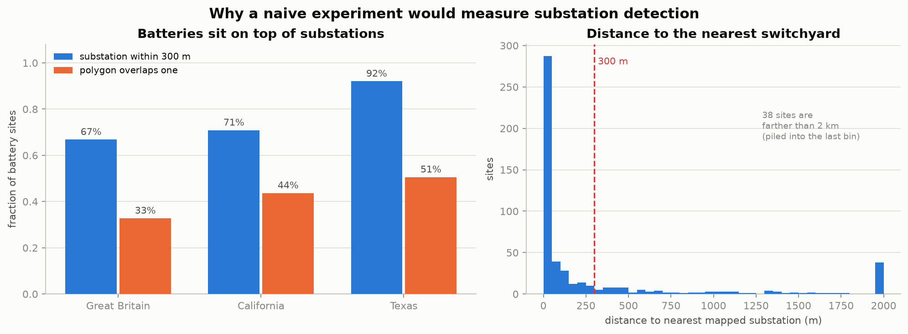
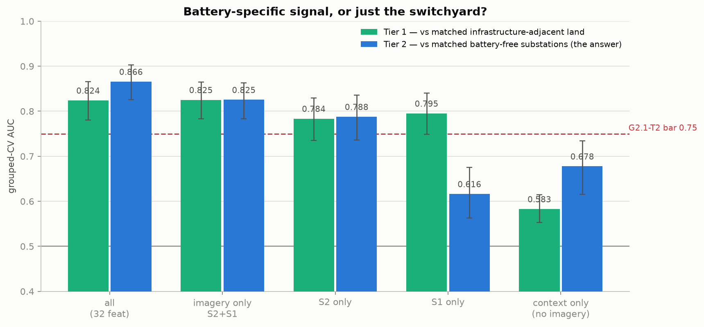
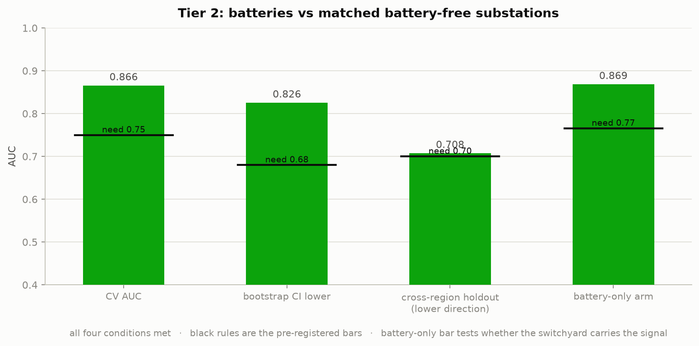
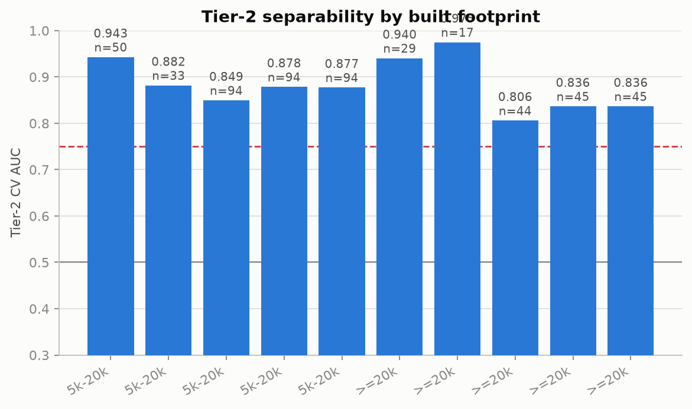

# Can battery storage be detected in Sentinel-1/Sentinel-2 imagery?

**Yes — and the signal is specific to the battery, not to the substation beside it.**

Grid-scale battery energy storage separates from area- and shape-matched *battery-free
substations* at a grouped-CV AUC of **0.866** (95% CI 0.826–0.903) across Great Britain,
California and Texas, with a cross-region holdout of **0.708** in the weaker transfer
direction. On Sentinel-1 and Sentinel-2 imagery alone, with no OSM-derived context
features, the figure is **0.825**.

Two pre-registered checks failed and are not waived; see [the qualifications](#what-would-change-this).
The full gate document, with every threshold fixed before any data existed, is
[`docs/issues/bess-detectability-feasibility.md`](issues/bess-detectability-feasibility.md).

| | |
|---|---|
| **Question** | Do battery storage systems produce a signal in Sentinel-1/Sentinel-2, with OSM battery power-plant labels as ground truth? |
| **Regions** | Great Britain, California, Texas — 511 mapped sites, 259 in the ≥20,000 m² headline set |
| **Imagery** | 389 cells × 0.1°, S2 + S1 RTC + Copernicus DEM, 6.9 GB, composited in 14 h |
| **Verdict** | Tier 2 **passes** G2.1 on all three conditions; the switchyard and siting-prior controls both pass |
| **GPU spent on training** | none |

---

## Why this was not a simple experiment

**There were no labels where the imagery was.** This project's composites cover Pakistan
and NW India. Those two countries contain exactly **one** `plant:source=battery` object
between them. So unlike the [run-of-river hydro study](hydro-feasibility.md), which reused
existing Pakistan imagery and cost ~50 MB, this one had to buy new regions outright.

**And batteries are built on top of substations.** Across the three regions, **76% of
mapped battery sites have a substation within 300 m and 41% of their polygons physically
overlap one** — in Texas, 92% and 63%. A substation is exactly what this repo's production
model already detects. So the naive experiment — "can we find batteries?" — would have
measured substation detection wearing a battery label.



That single fact shaped the whole design. Every positive is compared against a **matched
battery-free substation**, not against open countryside, and a separate arm re-scores each
site with any overlapping substation subtracted.

---

## What the production detector already says

Before training anything, the existing substation model (`v12_up2_s2only`, trained only on
Pakistan and NW India) was run over all 389 cells. It transfers well — it fires on 55% of
GB and **85% of Californian** transmission substations ≥20,000 m², against 0.714 measured
recall in its own domain — which is what makes its behaviour on batteries interpretable.

| region | co-located ≤300 m | overlaps | model AUC, batteries vs substations | battery-only |
|---|---|---|---|---|
| GB | 73% | 31% | **0.307** [0.236, 0.383] | 0.254 |
| California | 71% | 44% | **0.248** [0.179, 0.327] | 0.209 |
| Texas | **93%** | **63%** | 0.483 [0.395, 0.576] | 0.418 |

In GB and California the detector scores batteries **significantly below** comparable
substations. In Texas it cannot tell them apart at all — because Texan battery polygons
almost always *contain* a switchyard, so the model fires on that and saturates (median
`p_max` 0.996). The Texas number does not measure batteries; it measures how often a
battery label encloses a substation.

What replicates in all three regions is the mechanism rather than the verdict: **subtracting
the overlapping substation always lowers the score** (−0.053, −0.039, −0.065). The response
the production model gives a battery site comes from the switchyard inside it.

The practical consequence: re-ranking existing candidates is dead as a cheap product. It
would rank batteries *last*.

---

## The separability result



Given the battery class itself, a plain logistic regression on per-region image statistics
separates batteries from matched substations well:

| arm | features | CV AUC | 95% CI |
|---|---|---|---|
| all | 32 | **0.866** | 0.826–0.903 |
| **imagery only (S2 + S1)** | 27 | **0.825** | 0.783–0.863 |
| imagery, area-robust | 16 | 0.809 | 0.768–0.849 |
| S2 only | 21 | 0.788 | 0.736–0.836 |
| S1 only | 6 | 0.616 | 0.563–0.675 |
| context only (no imagery) | 5 | 0.678 | 0.615–0.734 |

The optical bands carry most of it; radar alone is weak here, which is the opposite of what
this project found for substations, where S1 beat S2 outright.



**The controls are what make this readable:**

- **The switchyard is not the source.** Re-scoring each site with overlapping substations
  subtracted gives **0.869** against 0.866 for the full footprint. Removing the substation
  does not reduce the signal.
- **It is not a siting prior.** Context alone — elevation, slope, distance to road, line
  and industrial land — gives 0.678 against 0.866. The gate would have flagged a gap under
  0.03; the gap is 0.188.
- **The geometry is honest.** The permutation null sits at a median of **0.486**. The hydro
  study's null sat at 0.564 purely because it compared irregular real polygons against
  circular control discs; here controls are a rotated, translated copy of the site's own
  polygon, and the null returns to chance.
- **Solar hybrids are not doing the work.** 9% of sites co-tag solar with the battery, and
  they score **lower** (0.816) than pure battery sites (0.894).



---

## What would change this

Three qualifications, in descending order of how much they matter.

**1. Two pre-registered checks failed, and are not waived.**

`G2.0-T2` required ≥270 matched controls and 251 were drawn. This is not fixable by drawing
harder — controls per site were raised 3 → 5 → 8 and the pool moved 232 → 248 → 251, because
the calipers rather than the candidate list are the binding constraint. The headline read
0.852, 0.877 and 0.866 across those runs, so the conclusion does not hinge on the shortfall,
but the gate is recorded as failed.

`P1` failed on region size: battery windows average 418 px against 386 for controls
(SMD 0.162). It was driven down from 0.368 and cannot reach zero, because small substations
vastly outnumber large ones and for most battery sites no equal-or-larger control exists
within 40 km. So the residual was **tested** rather than argued away: an arm that drops
every order statistic (`bright_p95`, `tex_std`, every `*_max`) and keeps only size-invariant
means returns 0.809 against 0.825.

Gate 0 also failed as pre-registered, on label size and on same-cell control availability,
and was [amended](issues/bess-detectability-feasibility.md#amendment-2026-09-02-before-any-stage-1-or-stage-2-number-existed)
in its own commit before any Stage 1 or Stage 2 number existed. The original verdicts stand
on the record.

**2. The imagery-only number is 0.825, not 0.866.** The pre-registered headline arm includes
five OSM-derived context features, and `d_line_m` alone scores **0.860** as a single
feature. That is real topology — a substation sits on the network, a battery sits beside it —
but it is not a signal in the imagery, and using the label source as a feature is circular
for a detection question. For the question as asked, 0.825 is the number.

**3. A mapping-convention confound cannot be excluded.** OSM mappers may outline batteries
tightly around the containers while drawing substation outlines around the whole fenced
compound, grass included. The red-edge bands B06/B07 leading the feature ranking is
consistent with a vegetation difference between two *polygon conventions* rather than
between two kinds of object. Settling this needs a hand-checked sample against
high-resolution imagery; it cannot be done from OSM alone. For a detector aimed at the
mapped class it matters less, but it qualifies any claim about physics.

One design expectation was also simply wrong. Tier 1 — batteries against matched generic
land — was pre-registered as the easy comparison and an upper bound, with a 0.85 bar. It
came in at 0.824, **below** Tier 2, because its own controls are matched on road, line and
industrial distance, which forces them to be infrastructure-adjacent land rather than open
countryside. It is not an upper bound and is not reported as one.

---

## Reproducing it

```bash
# Stage 0 -- labels and gates (three Geofabrik PBFs, ~4 GB)
pixi run python scripts/build_bess_labels.py --region all --refresh-pbf --write-cells

# imagery -- 389 cells, S2 + S1 + DEM, ~7 GB, ~14 h
systemd-run --user --unit=bess-fill --working-directory=$PWD \
  --setenv=PATH=$PWD/.pixi/envs/default/bin:/home/$USER/.pixi/bin:/usr/bin:/bin \
  /usr/bin/bash scripts/compose_bess_fill.sh

# Stage 1 -- what the production detector already says (~7 s/cell)
pixi run -e ml infer --aoi gb_bess --upsample 2 \
  --checkpoint data/models/stageA_v12_up2_s2only/terramind-sub-epoch=24-step=51000.ckpt \
  --out-dir data/predictions_bess
pixi run -e ml python scripts/bess_prob_probe.py --aoi gb_bess

# Stage 2 -- matched controls, then the gated model
pixi run -e ml python scripts/bess_detectability.py --tier 2 --run-name bess_final --n-controls 8
pixi run -e ml python scripts/bess_stage2_model.py  --tier 2 --run-name bess_final

pixi run python scripts/make_bess_figures.py
```

Every figure above is regenerated from persisted CSVs in `data/eval_results/`; no number in
this report is typed in by hand.

**Read the covariate balance table before any AUC.** It is printed first for that reason,
and the model refuses to declare a gate outcome when matching failed.
