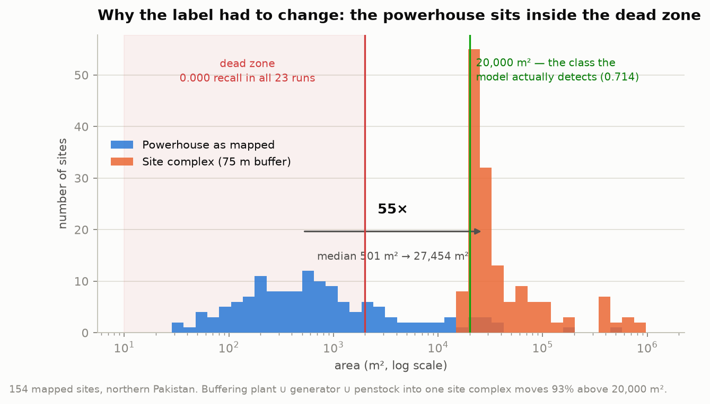
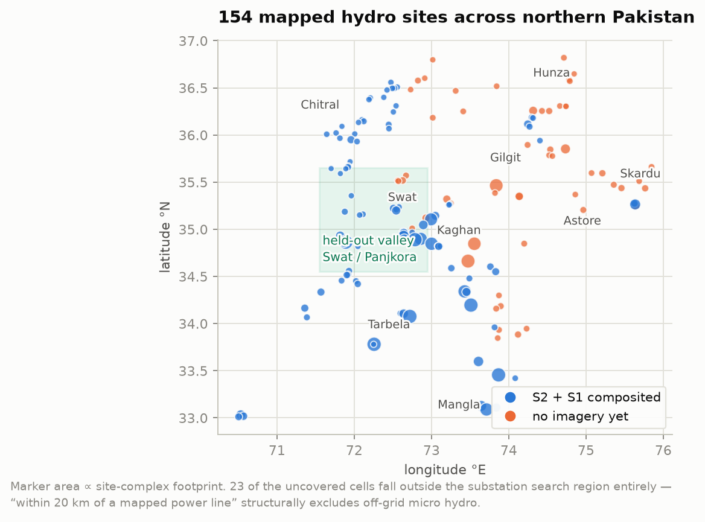
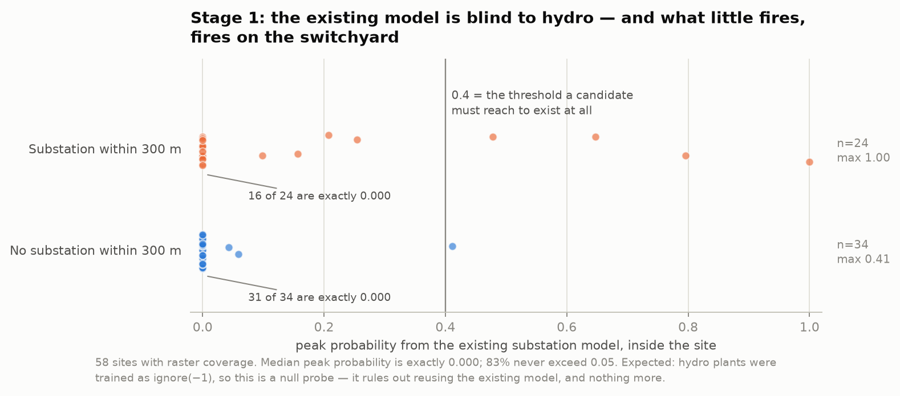
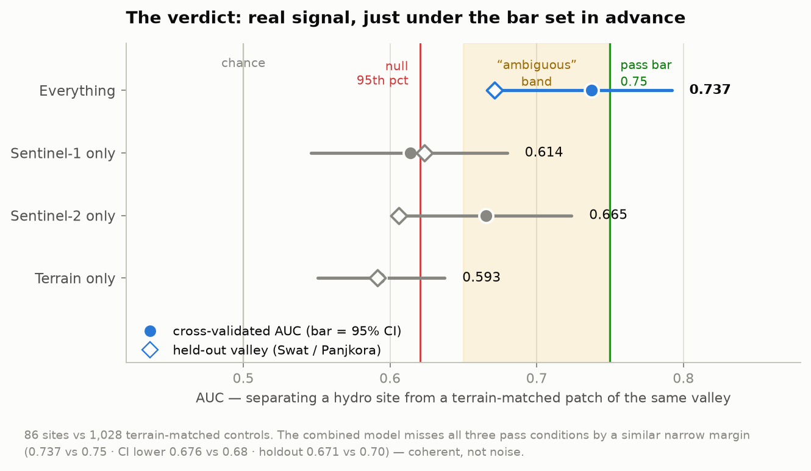
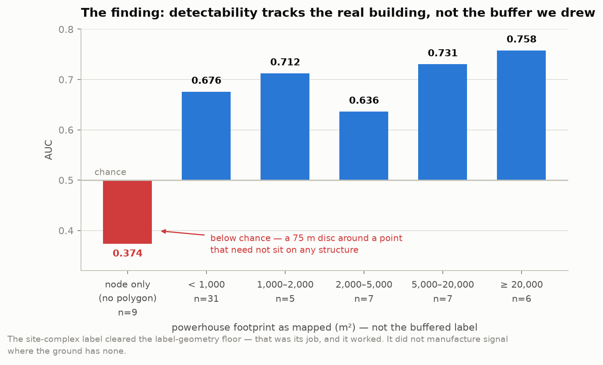
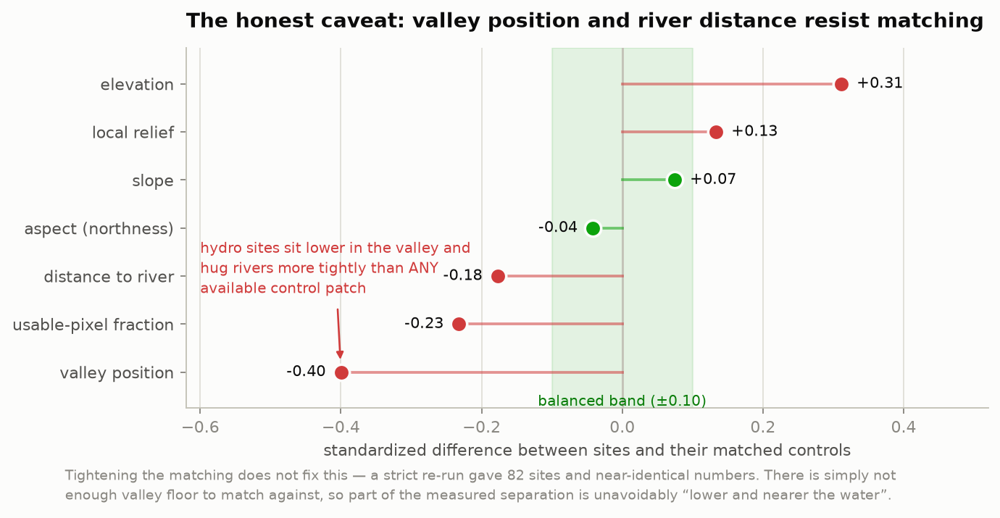
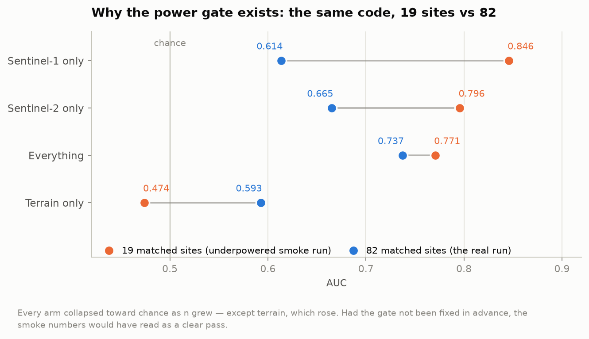

# Can we find small hydropower plants in northern Pakistan from space?

*A feasibility study, August 2026. Written to be read start to finish — no prior knowledge
of the codebase assumed.*

---

## The answer, up front

**Almost, but not quite.** There is a real signal — small run-of-river hydro sites *are*
distinguishable from the mountainside around them in Sentinel-1 and Sentinel-2 imagery. But
it measures **AUC 0.737** against a bar of **0.75** that we wrote down *before* looking at
any data. So the verdict is **"ambiguous"**: good enough that the idea isn't dead, not good
enough to justify spending days of GPU time on training.

Three things are worth knowing beyond that headline:

1. **The powerhouse itself is undetectable at 10 m resolution.** The median mapped
   powerhouse is 501 m² — about five Sentinel-2 pixels. We got a measurable signal only by
   redefining what we were looking for.
2. **How well we detect a site still depends on how big its *actual building* is**, not on
   the generous outline we drew around it. That's the study's most useful finding.
3. **A small-sample version of this same analysis said 0.846 and would have looked like a
   clear pass.** The gate we set in advance is the only reason we didn't believe it.

---

## What was asked

> *"Use our pipeline and the Sentinel-1 + 2 data to try to detect some of the pumped hydro
> in the north of Pakistan. In many cases long metal pipes lead to the generator in
> OpenStreetMap. I have mapped lots of this smaller pumped hydro in the north."*

One clarification before anything else. What's mapped in northern Pakistan is not
**pumped-storage** hydro (which pumps water uphill to store energy) — it's **run-of-river
micro hydro**: a small weir on a mountain stream, a channel along the hillside, a pressure
pipe (the *penstock*) dropping down the slope, and a small powerhouse at the bottom. There
is no pumped-storage class in the OSM data for this region. The satellite signature is the
same either way, and this study targets what is actually mapped.

The existing pipeline detects **electrical substations** — large fenced yards full of metal
— by fine-tuning a geospatial foundation model on OpenStreetMap labels. The question is
whether it can be pointed at something very different.

---

## Step 1: the problem, in one picture

Before any modelling, we measured how big these things actually are.



This is the whole difficulty on one chart. The blue distribution is the powerhouse as
mapped in OSM. The red zone is where this pipeline has **never once produced a detection**:
across all 23 model versions ever trained here, anything under 2,000 m² comes back with a
peak probability of *exactly zero*. Not "low confidence" — no response whatsoever.

The median powerhouse sits at 501 m². It is four times smaller than the smallest thing this
system has ever successfully detected.

The penstock doesn't rescue us either:

- `waterway=penstock` has **zero objects in all of Pakistan**. The tag people actually use
  is `usage=penstock`.
- Those pipes have a median length of **87 m** and are only a few metres wide — narrower
  than a single pixel.
- Most are tagged `tunnel=yes` or `location=underground`. They are literally not visible.
- Only about a third of plants have any pipe mapped at all.

### The design response: label the whole site, not the building

A hydropower plant is not just its powerhouse. On the ground it is a *complex*: intake
weir, headrace channel, forebay pond, the penstock scar down the slope, the powerhouse pad,
the tailrace, an access track, and construction spoil. That whole thing spans several
hundred metres.

So the label became the **union of everything belonging to one installation, buffered by
75 m** — the orange distribution above. Median area goes from 501 m² to **27,454 m²**, a
55× increase that puts **93% of sites** into the size class where this pipeline's measured
detection rate is 0.714.

This is legitimate rather than a trick, because the product is a *ranked list of places for
a mapper to look at*. A lead needs a location, not a precise outline.

---

## Where the sites are



154 sites across Gilgit-Baltistan, Chitral, Swat, Kohistan and Azad Kashmir, spread over
about a dozen valley systems. Marker size is the site-complex footprint.

Two practical things fell out of this map:

**We had to fetch new imagery for most of them.** Only 37% of sites had satellite
composites when we started. The reason is structural and worth flagging on its own: the
existing pipeline only downloads imagery for cells **within 20 km of a mapped power line**,
because that's where substations live. Off-grid micro hydro is, by definition, often not
near a mapped power line. **23 of the uncovered cells fall outside that search region
entirely.** We added a way to bypass it.

**The Swat / Panjkora valley was set aside as a held-out test.** It's one hydrological
system, ~130 km from the other large clusters, and — decisively — it already had imagery.
Kaghan, Hunza and Astore were disqualified as candidates because they had *zero* composited
cells: a test region you can't actually score isn't a test region.

---

## Step 2: does the existing model already see them?

The cheapest possible experiment. We already had substation-probability maps covering the
whole region on disk. If the existing model happened to light up at hydro sites — plausible,
since many have a small switchyard — the answer would be "just re-rank what you already
have", and we'd be done.



**It does not.** Median peak probability is exactly 0.000, and 83% of sites never exceed
0.05.

This was the *expected* result and we wrote down in advance that it wouldn't count as
evidence against feasibility. The reason is specific: when the substation model was trained,
hydro power plants were explicitly marked **"ignore"** in the training masks — the model was
never taught they were interesting, nor that they were background. It has no opinion about
them. So this rules out the free option and nothing else.

The interesting detail is the split. Sites *with* a substation within 300 m reach a maximum
of **1.00**. Sites *without* one top out at **0.41**. Whatever does fire is firing on the
switchyard, not on the hydro plant.

---

## Step 3: the real test

The decisive question: **given the terrain, can you tell a hydro site from a patch of the
same valley that isn't one?**

That "given the terrain" is doing a lot of work, and it's the hardest part of the study to
get right. Hydro plants sit on valley floors next to rivers. So does almost nothing else in
a mountain range — most of the landscape is steep hillside. If you compare hydro sites
against *random* patches of Gilgit-Baltistan, you get a beautiful result that means only
"valley floors look different from mountainsides." Which we already knew.

So every site was compared against ~14 **terrain-matched control patches**: same 0.1° cell,
same elevation band, same slope, same aspect, same distance-to-river, same local relief, and
the same area — but at least 1 km from any hydro site and 500 m from any other
infrastructure. This required adding elevation data to the project, which had none.



**AUC 0.737**, cross-validated with whole valleys held out of each fold. On the untouched
Swat/Panjkora valley: 0.671.

The signal is real — a randomisation test (shuffling the labels 200 times) puts the
noise ceiling at 0.621, well below what we measured, with p < 0.001. But it lands in the
band we'd declared "not good enough to spend GPU on, not bad enough to abandon", and it
misses **all three** pass conditions by a similar small margin:

| condition | needed | got |
|---|---|---|
| cross-validated AUC | ≥ 0.75 | 0.737 |
| lower bound of the confidence interval | ≥ 0.68 | 0.676 |
| held-out valley | ≥ 0.70 | 0.671 |

Missing all three consistently is more convincing than missing one badly — it reads as a
genuine "just short" rather than a fluke.

Note also that **terrain alone scores 0.593**, not 0.500. That's the residue of the
confound described above, and we come back to it below.

---

## The finding that matters most

Splitting the result by how big each site's *actual powerhouse* is:



**Detectability still tracks the real building, not the outline we drew around it.**

This is the honest limit of the site-complex trick. Buffering the label got us over a
*bookkeeping* floor — the pipeline's machinery genuinely cannot handle a 5-pixel target, and
the buffer fixed that. But it could not conjure a signal where the ground offers none. A
plant with a 30,000 m² powerhouse is detectable at 0.758; one that's a shed is much closer
to a coin flip.

The `node only` bar is instructive: these are sites mapped as a single OSM point with no
outline at all. Their "site complex" is a 75 m circle drawn around a dot that need not sit
on any actual structure. They score **below chance** — the model is reliably finding
*nothing* there. They should be dropped from any future training set rather than treated as
positives.

---

## Two things that could be better, stated plainly

### The controls aren't perfectly matched, and can't be



Slope and aspect matched cleanly. Valley position and distance-to-river did not, and
**tightening the matching rules doesn't fix it** — a strict re-run gave essentially
identical numbers.

The reason is real rather than technical: hydro sites sit at the very bottom of the
valley-position distribution and hug rivers more tightly than *any available control patch*
in these catchments. There simply isn't enough valley floor to match against. So some part
of the measured 0.737 is unavoidably "lower down and nearer the water" rather than "looks
like a power plant". The terrain-only score of 0.593 is roughly the size of that residue.

Treat 0.737 as an **upper bound**.

### A small sample lied to us, convincingly

Partway through, before all the imagery had downloaded, we ran the same analysis on the 19
sites that were ready — purely to check the code worked.



Sentinel-1 alone read **0.846**. That would have been the best number in the study and a
clear pass. At full sample it is **0.614**.

Every imagery-based arm collapsed toward chance as the sample grew — and terrain, the one
thing that *should* be flat, rose. Nothing about the code changed. This is exactly why the
minimum-sample requirement was written down as a gate rather than a footnote, and it mirrors
an earlier episode in this project where two identical training runs differing only by
random seed scored 0.44 and 0.22.

---

## So what should happen next?

**The pre-registered rule allows exactly one more thing to be tried**, then a decision:
stacking multiple Sentinel-1 dates and taking the brightest value per pixel, rather than the
median. Radar returns from small metal structures flicker between passes, and a median
composite actively suppresses them. This is the single most likely thing to move the number,
and it was named as the next step by an earlier study in this project for the same reason.

Deliberately *not* allowed: trying more features, tuning thresholds, or re-running until
something clears the bar. That's how a study talks itself into a result.

**If you'd rather stop here, that's a defensible read too.** The evidence says a detector
for these sites would work reasonably for the larger plants and poorly for the small ones,
which describes a useful-but-narrow tool.

**If it does go ahead**, three things are already settled:

- Scope it to sites with a powerhouse above ~2,000 m². That's where the signal is — about
  35 sites in the current corpus, which is a small training set and should be said out loud.
- Drop the node-only sites.
- Match control *shape*, not just area. The randomisation test came out at 0.564 rather than
  0.500, and the likeliest cause is that real sites are irregular polygons while controls
  are circles.

---

## Things that were broken along the way

Seven bugs surfaced during this work. **None of them crashed anything** — every one would
have quietly produced a wrong number. Recorded here because they generalise.

| what | why it matters |
|---|---|
| `pixi run compose` was broken in the data environment **for every sensor** | A module-level import pulled in a library only installed in the ML environment. Pre-existing, unrelated to hydro. Fixed. |
| OSM export emitted every closed shape **twice** | 252 of 256 plants arrived duplicated — once as an outline, once as an area. Would have double-counted most of the corpus. |
| `buffer(0)` on a point returns an **empty** shape | This is the standard idiom for repairing broken polygons. Applied to points, it silently deleted all 59 sites mapped as a single node. |
| Terrain aspect came out **mirrored north–south** | Image rows run top-to-bottom but latitude runs bottom-to-top. Slope steepness was perfectly correct, which is what makes it dangerous — only the direction was wrong, and it drives which slopes are in winter shadow. |
| Confidence intervals were computed on **training** predictions | Reported a lower bound of 0.975 against a point estimate of 0.771. Since one of the pass conditions keys on that lower bound, this was a false-pass generator. |
| Balance was measured over **unmatched** sites too | The sites that failed to find controls were the steep ones, which manufactured a large apparent slope imbalance. |
| Distance-to-river was a constant | The river layer was never extracted, so every distance was the "nothing found" sentinel value. Fixing it took matched sites from 6 to 19 in the smoke run. |

---

## Reproducing this

Everything lives on the `hydro-feasibility` branch. The pass/fail thresholds were committed
**before** any result was computed — that history is in the git log, deliberately.

```bash
# 1. Build the labels from OpenStreetMap (downloads a fresh country extract)
pixi run python scripts/build_hydro_labels.py --refresh-pbf

# 2. Fetch imagery for sites the substation search region misses
pixi run compose --aoi pakistan --sensor s2  --cells-file data/hydro_all_cells.txt
pixi run compose --aoi pakistan --sensor s1  --cells-file data/hydro_all_cells.txt
pixi run compose --aoi pakistan --sensor dem --cells-file data/hydro_all_cells.txt

# 3. Free probe of the existing substation model (no GPU)
pixi run python scripts/hydro_prob_probe.py

# 4. The real test (no GPU, ~1-2 h)
pixi run -e ml python scripts/hydro_detectability.py --run-name north_pk_v1
pixi run -e ml python scripts/hydro_stage4_model.py  --run-name north_pk_v1

# 5. Regenerate every figure in this document
pixi run python scripts/make_hydro_figures.py
```

**Read the covariate balance table before believing any AUC.** It is what licenses the rest
of the numbers, and the script prints it first for that reason.

- Full technical log, with the pre-registered thresholds and every measured value:
  [`docs/issues/hydro-small-runofriver-feasibility.md`](issues/hydro-small-runofriver-feasibility.md)
- Raw per-site outputs: `data/eval_results/hydro_*.csv`
- Every figure above is generated from those CSVs by `scripts/make_hydro_figures.py` — no
  number in this document was typed in by hand.
