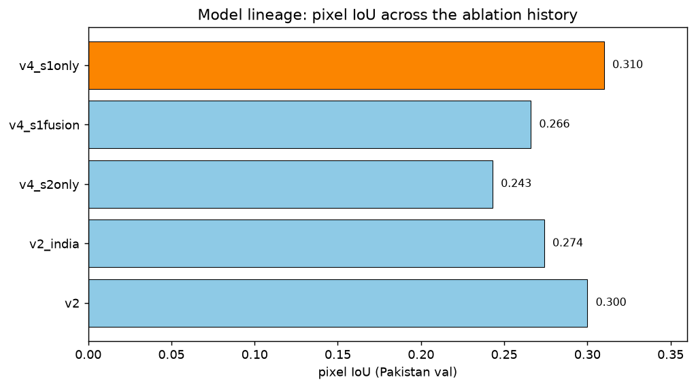
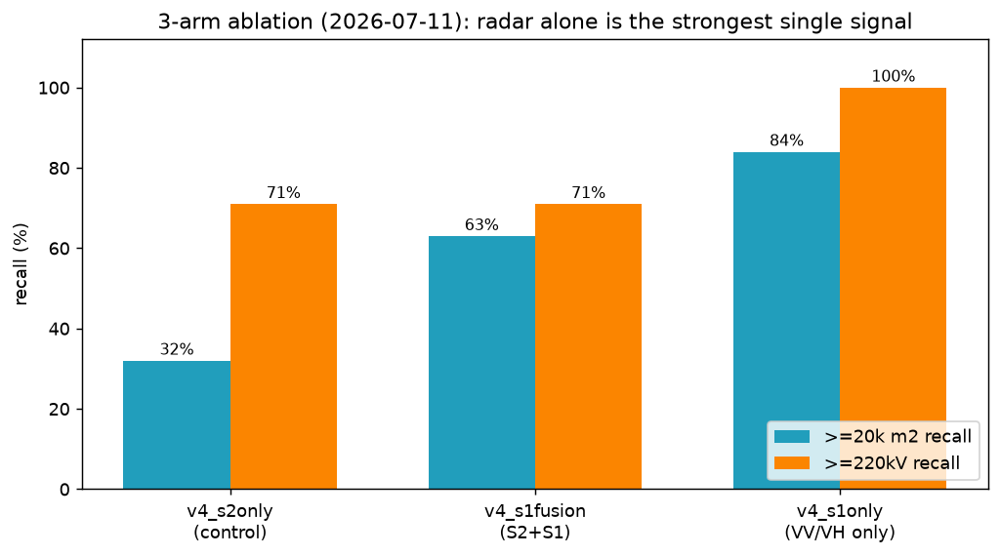

# Model lineage: a debugging story

The model behind subdetect didn't arrive fully formed — it's the result of a
sequence of experiments, several of which were *negative* results that changed
direction. This page tells that story in order, because the reasoning behind each
change is more useful than the final numbers alone.

## The arc

**v1 — too small a floor, the model doesn't learn.** Training masks initially
treated every substation polygon ≥ 1,000 m² as a positive pixel. Real substations
span a huge size range, and the smallest ones are only a handful of 10 m pixels —
essentially unlearnable texture at this resolution. The loss ended up dominated
by these tiny, ambiguous targets, and the model underfit even on its own training
data (pixel IoU for the substation class ≤ 0.11).

**v2 — raise the floor, it works.** Restricting training to substations
≥ 20,000 m² (roughly 200 pixels — large, detectable, transmission-class
installations) fixed the underfitting immediately: pixel IoU 0.30.

**v2_india — more data helps recall, but precision on new leads collapses.**
Adding an India training pilot (same climatic/agricultural domain as the Pakistan
inference target) pushed recall further, but manual review of the top-ranked
*new* (unmapped) candidates found the overwhelming majority were false
positives — mostly bare/exposed natural land confused for a substation's gravel
yard in single-date optical imagery.

**v3 / v3b — hard-negative mining recovers precision.** Since none of those
false-positive locations carry a substation label, chips built there get an
all-background mask automatically — directly teaching the model its own specific
mistake, at zero new-imagery cost (`scripts/mine_hard_negatives.py`).

**v4 — does Sentinel-1 fusion even help?** The dominant false-positive class
(bare land) is spectrally similar to a gravel yard in optical imagery but looks
nothing like one in radar — substation gantries and busbars are corner
reflectors, bright in cross-polarized VH; bare soil scatters forward, staying
dark. Measured directly: **VH backscatter AUC 0.89** separating real substations
from human-reviewed bare-land false positives (`scripts/s1_separability.py`).
That motivated a genuine architectural fusion model (token-level mid-fusion
inside the TerraMind ViT, both modalities trained jointly) — see the ablation
below. The surprising result: **fusion lost to radar alone.**

**v5 (in progress) — remove the floor again, this time with the lessons
learned.** `sindh_test` evaluation showed 88% of mapped substations are *below*
the 20k m² training floor, with only 34% pipeline recall on them (vs. 79% for
≥20k m² installations) — the same underfitting risk v1 hit, but now with a tuned
loss, the S1 modality, and roughly 8× more positive training chips than v1 ever
had. See [below](#v5-removing-the-floor-again) for real, already-measured results.

## The 3-arm ablation (2026-07-11)

Fresh init, identical chips/recipe, only the input modality differs:





| arm (Pakistan val, 19 installs) | pixel IoU | F1 | ≥20k m² recall | ≥220 kV recall |
|---|---|---|---|---|
| `v4_s2only` (control) | 0.243 | 0.391 | 32% | 71% |
| `v4_s1fusion` (S2+S1, mid-fusion) | 0.266 | 0.420 | 63% | 71% |
| `v4_s1only` (VV/VH only) | **0.310** | **0.473** | **84%** | **100%** |

Radar alone posted the best numbers of any model in the project up to that
point. The naive mean-merge fusion architecture *diluted* rather than combined
the two signals — a real, measured negative result, not a hypothesis. Caveats
worth keeping in mind: a 19-installation validation set and a single training
seed; if fusion is revisited, the README suggests concat-merge or longer
training as the next thing to try, given the S1/S2 false-positive *profiles*
differ (S2 models fail on bare land, S1 models fail on other radar-bright metal
structures like industry/rail) — genuine complementary fusion should in
principle be possible, this specific merge strategy just didn't achieve it.

## v5: removing the floor again

Two arms retrained on a floor-removed chip set (`min_area_m2=0` — every
substation polygon becomes a positive training pixel, not just ≥20k m² ones),
otherwise identical architecture/loss/schedule to v4. Evaluated head-to-head
against the matching v4 checkpoint on the *same* no-floor validation chips (196
chips), so the numbers below are directly comparable to each other but **not**
to the v4 table above, whose validation masks only ever contained ≥20k m²
targets in the first place.

| | v4 s1only | v5 s1only | v4 s2only | v5 s2only |
|---|---|---|---|---|
| pixel IoU | 0.125 | **0.236** | 0.136 | **0.158** |
| pixel F1 | 0.222 | **0.382** | 0.239 | **0.272** |
| 2,000–5,000 m² recall | 28.4% | **36.5%** | 4.1% | 2.7% |
| 5,000–20,000 m² recall | 57.4% | **66.2%** | 11.8% | **27.9%** |
| ≥20,000 m² recall | 71.4% | 71.4% (unchanged) | 33.3% | **42.9%** |
| false positives (pixels) | 70,658 | **16,620** | 16,751 | 18,296 |

The key result: **s1only's recall on the size class the floor was originally
raised to protect (≥20k m²) didn't regress at all** (71.4% both), while recall
below that floor improved substantially and false positives dropped sharply.
The 2026-07-08 underfitting failure mode did not recur — the combination of a
tuned Tversky loss, the S1 modality, and far more positive training data
evidently gave the model enough signal to handle small substations without
diluting the large-substation objective. One flat spot: the smallest bucket
(1,000–2,000 m²) stayed at 0% recall for every model tested regardless of
training regime — that looks like a genuine resolution floor (≤14 pixels at
10 m), not something a training change can fix.

**Fusion retrain, in progress as of this writing:** the same no-floor chip set
is also being used to re-test the v4 fusion ablation, to separate two possible
explanations for fusion's v4 loss that were previously confounded: (a) the
mean-merge architecture genuinely dilutes signal, or (b) `v4_s1fusion` was just
as data-starved as the old `v4_s1only` baseline and never got a fair test. If
v5's fusion arm still loses to `v5_s1only` with the data variable now matched,
that confirms the merge mechanism is the real bottleneck. If it closes the gap
or wins, the original ablation was confounded by data starvation rather than
architecture. This section will be updated with the result once training
finishes and is committed.

## v6–v8: chasing the S1 arm with data, not architecture

After v5, every experiment through v8 changed the *chip index* feeding
`v5_s1only`'s exact architecture/loss/schedule — nothing else. That's a
deliberate methodological choice: it isolates data effects from architecture
effects, at the cost of needing a metric that survives a chip-index rebuild
(see [Fixing the evaluation itself](#fixing-the-evaluation-itself) below — this
section is written with the benefit of that later fix).

**v6/v6b/v6c — S1+NDVI label refinement.** `label_refine.py` shrinks oversized
OSM substation polygons onto their real S1-backscatter core, using S2 NDVI as
the actual boundary signal (see its own module docstring for the full
mechanism). v6 added a Yunnan hard-negative batch; v6b dropped it for a
cleaner comparison; v6c added a building-density guard (an Overpass check that
demotes a polygon to `village` — not refined — if buildings cover more than
30% of its S1 core, since rooftops double-bounce radar just like switchgear).
All three **regressed** against v5 on `sindh_test`: v6b's false-positive count
rose 27% and ≥20k m² recall fell from 83.3% to 72.2%. Tightening labels
apparently removed real signal (the model was evidently using some of the
"oversized" polygon area productively) without recovering enough precision to
compensate.

**v7 — voltage-tagged substations only.** Restricting positive supervision to
OSM polygons carrying a `voltage` tag cut the chip count 57% (untagged
substations are just as real, only less well-documented) and caused a severe
data-starvation collapse: pixel IoU 0.236 → 0.158, false positives more than
doubled, `sindh_test` P@50 fell from 0.38 to 0.14. The clearest single result
in this whole run of experiments: **data quantity dominates label purity** for
this model at this scale.

**v8 / v8_run2 — oversample tagged substations instead of excluding untagged
ones.** A less destructive alternative to v7: voltage-tagged substations get 2
jittered training chips instead of 1 (`--voltage-weight 2`), untagged ones
still get 1. v8's first run looked like the best model yet on `sindh_test`
(P@50 0.44, the high point of the whole v6–v8 series) — but v8_run2, an
identical config reseeded from scratch, dropped to P@50 0.22, both worse than
v5 (0.38) and worse than v8's first attempt on the *same recipe*. **That
delta is reseed noise, not a real effect** — a single training run is not
enough evidence to promote a checkpoint to production, however good its first
number looks.

## Fixing the evaluation itself

The v6–v8 series exposed a real methodological gap: `val/mIoU` is computed
against each config's own val split, and every config in this series rebuilt
its chip index — sometimes with refined masks, sometimes with a different
voltage filter, sometimes with more or fewer chips. Two runs' `val/mIoU`
numbers are simply not measuring the same target. Worse, they don't even track
field quality reliably: v8_run2 posted the *best* val IoU_1 (0.254) of every
run in this table, while being a field regression.

`scripts/field_eval.py` fixes this by scoring every run against a single fixed
ground truth — raw, un-refined OSM substation polygons (`substations_poly.parquet`
+ node discs) that never change between chip-index rebuilds — and against the
same real region (`sindh_test`), not a val split that moves with every rebuild:

```bash
pixi run -e ml python scripts/field_eval.py --run-name v9_s2only \
    --prob-dir data/osmose_regions/sindh_test_v9/prob --labels pakistan
```

It reports component-level AUC/P@20/P@50 (does a ranked candidate polygon hit
a real substation), installation-level recall bucketed by area (does *any*
candidate hit each real substation), and a false-positive proxy — appending
one row per run to `data/eval_results/field_eval.csv`, so every future run is
directly comparable to every past one without rerunning anything:

| run | AUC | P@20 | P@50 | hits/candidates |
|---|---|---|---|---|
| v5_s1only | 0.747 | 0.15 | **0.38** | 29/221 |
| v6 | 0.666 | 0.10 | 0.26 | 26/368 |
| v6b | 0.719 | 0.15 | 0.32 | 29/350 |
| v6c | 0.638 | 0.10 | 0.28 | 28/300 |
| v7 | 0.721 | 0.15 | **0.14** | 44/631 |
| v8 | 0.738 | 0.20 | **0.44** | 38/294 |
| v8_run2 | 0.792 | 0.15 | 0.22 | 42/320 |

(Backfilled 2026-07-17 from prob rasters already on disk for every historical
run; full command in the table's own generation history is `scripts/field_eval.py
--run-name <v> --prob-dir data/osmose_regions/sindh_test_<v>/prob --labels pakistan`
for each row.)

`scripts/eval_small_subs.py` (re-run against v5 on the current chip index)
independently confirms the size-floor problem this whole lineage keeps running
into: 0/15 detected below 2,000 m², climbing only to 74–90% by the 10,000–20,000
m² bucket. That gap — not label purity, not voltage tags — is the largest
still-open lever in this project; see [Expanding the training data](expanding-training-data.md)
for what's been tried against it so far.

### Fixing it again: `eval_version` 2 (2026-08-15)

`field_eval` removed the moving-target problem but carried two defects of its own,
both found by `scripts/diagnose_missed_large.py`, which asks *where* a missed
substation is lost rather than only whether it was found.

**The recall denominator was a bounding box.** Ground truth was selected with
`v2f.total_bounds` — the bounding box of surviving candidates. But the inferred
area is a ragged set of ROI-selected cells, not a rectangle. On `sindh_test`,
**53 of ~163 substations (roughly a third) were never covered by any probability
raster** and were counted as misses anyway, including the region's two largest
(211,000 and 185,000 m²) and one sitting 51 km outside the nearest inferred cell.
Worse, the box is candidate-dependent, so the denominator moved between runs:
`n_20000-inf` was 21 for some rows and 19 for others in the same region, meaning
recall figures were not strictly comparable to each other — the exact failure
`field_eval` was built to end.

**One constant was doing two jobs.** `settings.min_sub_area_m2` (20,000 m², the
*label* floor) was also the *candidate* filter. A component had to be as large as
the biggest ground-truth bucket to count at all, so any substation below 20,000 m²
could only be detected via an over-predicted footprint. That filter was discarding
20 correctly-detected substations whose components carried a median peak
probability of **0.53**.

Both are fixed: `postprocess.raster_coverage()` builds the denominator from the
actual raster footprints (membership by centroid, in an equal-area CRS), and
`MIN_CAND_AREA_M2` (1,000 m²) is now independent of the label floor. Rows carry
`eval_version` and `min_cand_area_m2`; **only compare rows of equal
`eval_version`.** The v1 history is preserved in the same CSV and in
`field_eval_v1_backup.csv`.

All 23 historical runs were re-baselined from the prob rasters on disk. Every run
gained; the production model as an example:

| bucket | v1 | v2 |
|---|---|---|
| 1,000–2,000 m² | 0.000 | 0.000 |
| 2,000–5,000 m² | 0.066 | **0.256** |
| 5,000–20,000 m² | 0.328 | **0.700** |
| ≥20,000 m² | 0.526 | **0.714** |

P@50 rose 0.64 → 0.74 and candidates 223 → 650. AUC fell 0.955 → 0.868, which is
expected rather than a regression: the ranking task is now over a much larger and
harder candidate set, and the old number was flattered by a filter that had
already deleted most of the difficult cases.

**What survives the correction, and what does not.** Precision-style rankings are
stable across the 23 runs (Spearman ρ = 0.94 on P@50, 0.94 on P@20, 0.91 on AUC),
so conclusions in this document that rest on P@50 stand — including the promotion
of `v12_up2_mean_fusion`, which remains best on P@50 and gains the 5,000–20,000 m²
crown. Recall-based orderings are considerably less stable (ρ = 0.67–0.74), and
the best-by-recall run changes for three of four buckets: 5,000–20,000 m² was v7,
now v12_up2_mean_fusion; ≥20,000 m² was v5_s1only, now v6c. **Any recall-based
claim in this document that predates 2026-08-15 should be re-read against the v2
rows**, and the models were consistently better than the v1 numbers reported.

One thing the correction does not touch: the 1,000–2,000 m² bucket reads **0.000
in all 23 runs** under v2 as under v1, on n = 9. Neither defect was masking that
floor, and `diagnose_missed_large.py` shows why — nine of nine are `lost:silent`
with a peak probability inside the polygon of exactly 0.000. The model does not
respond weakly there; it does not respond at all.

## v9: growing the data-starved S2-only arm

Every v6–v8 experiment touched the S1 arm's chip index; the S2-only arm —
the weakest link in the [3-arm ablation](#the-3-arm-ablation-2026-07-11) and
still weak after v5 (val IoU_1 0.111 vs. 0.212 for s1only) — never got more
data thrown at it. v9 does exactly that, using a genuinely external dataset
rather than more local Pakistan/India chips: see
[Expanding the training data](expanding-training-data.md) for the full
walkthrough (the TorchGeo Substation dataset merge, and a global
hard-negative-mining pass built to counter the resulting 94.5%-positive chip
skew). As of this writing, v9 training is still in progress; this section
will be updated with final numbers once it completes and is field-evaluated.

## Open problem: the 0.5 plateau

The production decision-level fusion, `P = P_S1only × (0.5 + 0.5 · P_S2only)`,
has a structural property worth knowing about: any pixel where the S1 model is
fully confident but the S2 model is neutral evaluates to *exactly* 0.5,
regardless of how confident S1 actually was. Measured on real pilot data,
roughly 60% of Osmose-pilot candidates land on this plateau — see it directly in
the [worked example](worked-example.md#c-predicted-probability).

This was tested rigorously (`scripts/eval_polygonize_v2.py`, validated against
both the Yunnan pilot and `sindh_test` real labels): no statistic computed from
the *fused* probability raster alone — not max, not top-decile mean, not mean —
can meaningfully rank candidates within that plateau (measured within-plateau
AUC 0.538 — no better than random — on a 23-positive `sindh_test` sample; the
Yunnan pilot only had 3 plateau positives, too few to trust on its own but
directionally consistent). The information genuinely isn't there once the two
models' outputs are compressed into one number. The fix isn't a smarter
statistic; it's exposing what the fusion
discards — writing separate `mean_s1`/`mean_s2` columns per candidate (a small
change to `gated_inference` in `scripts/osmose_detect.py`) so ranking can use
both models' opinions instead of their collapsed product. Not yet implemented as
of this writing.

**Update 2026-07-17:** re-running `scripts/eval_decision_fusion.py` against the
v5 checkpoints (it had only ever been validated against v4) turned up a live
candidate fix for the plateau problem, not just a diagnosis of it — plain
arithmetic mean scored *higher* than the production `s1_gated` formula, at
equal ≥20k m² recall:

| combo | bestIoU | @thr | recall≥20k |
|---|---|---|---|
| s1_gated (production) | 0.238 | 0.3 | 15/18 |
| **mean** | **0.254** | 0.5 | 15/18 |
| max | 0.235 | 0.6 | 15/18 |
| s1only alone | 0.237 | 0.6 | 15/18 |

Not yet adopted in `osmose_detect.py`: the hysteresis polygonization thresholds
(seed 0.4, grow 0.2) were specifically tuned to sit below `s1_gated`'s 0.5
plateau, and switching the fusion formula changes that plateau's location and
shape. Swapping formulas needs its own field-validation pass (`sindh_test` via
`scripts/field_eval.py`), not just this val-chip comparison, before it's safe
to ship.

## What *did* improve ranking: hysteresis + a line-proximity prior

Two changes were tested and adopted together, validated on `sindh_test` against
real Pakistan substation labels:

- **Hysteresis polygonization** (seed 0.4, grow 0.2, replacing a single 0.3
  threshold) merged fragmented detections and recovered one additional mapped
  substation on both validation corpora, at unchanged ranking AUC.
- **Line-proximity prior**: real substations sit *on* the transmission grid — 75%
  of true detections in `sindh_test` had `line_dist_m = 0`, vs. a 1.8 km median
  for non-hits. Folding `exp(−line_dist_m / 500)` into `rank_score` lifted AUC
  0.769 → 0.967 and precision@20 0.70 → 0.90 — the strongest single ranking
  signal measured in this project.

Full detail and the output-column reference: [Osmose-guided detection](osmose-detect.md).

## A label bias nobody had measured, and the two arms testing it

Porting `earthpv`'s fraction-regression head (2026-08-15) turned up something more
basic than the head itself. `chips.py::_burn_mask` has always rasterized positives
with `all_touched=True`, which marks every pixel the polygon touches. Measured on
502 real installations lying entirely inside a training chip, comparing burned
pixel area against true geodesic area:

| bucket | n | `all_touched=True` | centre-in | 10x supersampled |
|---|---|---|---|---|
| 1,000–2,000 m² | 38 | **1.70x** | 0.98x | 1.00x |
| 2,000–5,000 m² | 139 | 1.47x | 1.00x | 1.00x |
| 5,000–20,000 m² | 132 | 1.29x | 1.00x | 1.00x |
| ≥20,000 m² | 144 | 1.13x | 1.00x | 1.00x |

Every checkpoint in this document was trained on a footprint whose bias varies
monotonically with size, worst in exactly the bucket that has read **0% recall in
every model tested** and has been attributed to a resolution floor. Whether some of
that "floor" is supervision noise rather than optics is now a testable question.

Both arms re-burn the masks of the **existing v11b index in place**
(`scripts/build_reburn_chip_index.py`), leaving imagery, chip centres and the
train/val split byte-identical, so each is a one-variable A/B. Before re-burning
anything the script reconstructs a sample of masks the original way and requires an
exact match, which is what proves the label settings match the corpus (they do: raw
OSM labels, no size floor — 12/12 exact on both AOIs).

**v16_honestburn — run and read this one first.** `all_touched=False` and nothing
else. Still a two-class mask, still Tversky, still a probability raster out, so
every downstream constant keeps its meaning: the 0.3 threshold, the hysteresis
seeds, the fusion formula. A win here ships with no integration work.

**v15_fraction — the ported head.** Float32 sub-pixel coverage in [0, 1] against a
1-channel sigmoid regression head with a zero-inflation-weighted MSE. It removes
the same bias *and* adds genuine sub-pixel targets. The comparison that isolates
its own contribution is therefore **v15 against v16**, not v15 against v11b.

### Temper the expectation

Removing the inflation drops positive pixels only 754,542 → 669,847 (−11.2%) across
the re-burned chips, and −1.0% corpus-wide. The pixel total — and therefore the loss
— is dominated by large substations, which were only ~1.13x inflated. The 1.70x
correction lands on the smallest installations, which contribute a negligible share
of pixels. So these arms nudge the aggregate gradient by ~11% while fixing the
labels of precisely the class that has never been detected. That is a narrower bet
than the 1.70x headline suggests, and it is the honest way to read a null result.

Two further caveats. Four of 3,684 re-burned chips lose their positives entirely
(sliver polygons whose centres miss every pixel) and become negative-only — a tiny
second label change beyond the bias fix. And 26,496 of the 32,921 chips come from
the TorchGeo Substation dataset, whose source polygons are not on disk: under v16
they keep their original masks untouched, and under v15 they are cast to hard
{0, 1}, so ~80% of the fraction corpus supplies no sub-pixel information. If v15
comes back neutral, `--target fraction --osm-only` builds the complementary arm
before concluding the target representation does not help.

### How to judge

Not `val/IoU_1` or `val/RMSE` — positive pixel counts change, so IoU is not
comparable to v11b even with an identical split, and RMSE is dominated by
background zeros. Both are checkpoint-selection monitors only. Judge on
`scripts/eval_small_subs.py` size buckets and `scripts/field_eval.py` on
`sindh_test`. The decision threshold does not transfer between heads: 0.3 on a
class probability means "30% confident", 0.3 on a fraction raster means "30% of
this pixel is substation". And given the v8 episode (P@50 0.45 → 0.05 on an
identical reseed), a positive result needs a reseed control before it is believed.

Neither arm has been trained as of this writing; this section records the
measurement and the experiment design.
